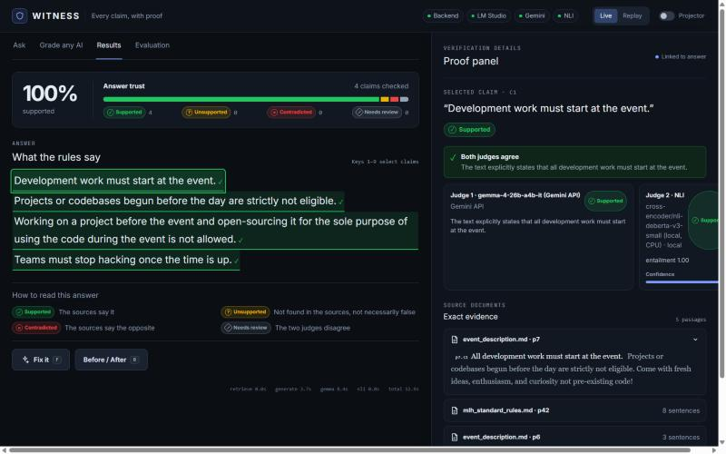
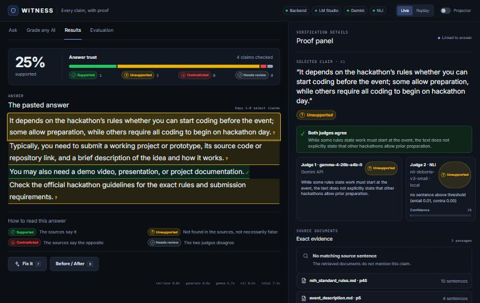
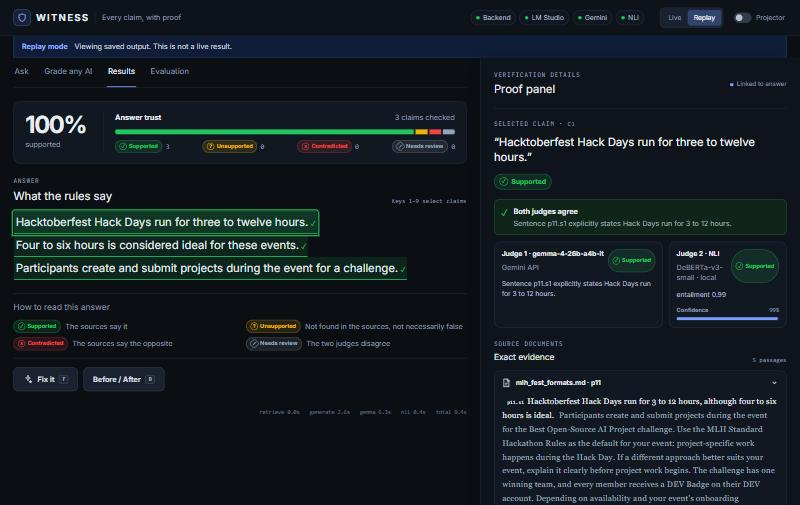
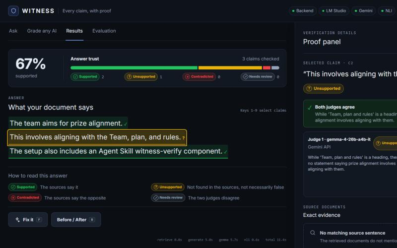
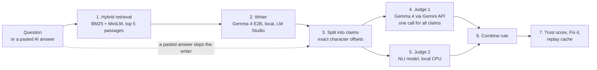

# WITNESS

### Every claim, with proof.

> **AI sounds equally sure when it's right and when it's wrong. WITNESS shows you which is which, sentence by sentence, with the exact source line as proof.**

WITNESS checks an AI-written answer against your source documents. It splits the answer into individual claims, has **two independent judges** verify each one, and marks every sentence **Supported, Unsupported, Contradicted or Needs review**. Click a sentence and the exact source sentence lights up. Press **Fix it** and you get a clean answer containing only what the sources actually say, with citations.

Built at **Hacktoberfest Hack Day Hamirpur × GDG Ludhiana** (NIT Hamirpur, in partnership with Major League Hacking). Open source under [Apache-2.0](LICENSE).



---

## Contents
[The problem](#the-problem) · [Our solution](#our-solution) · [See it in action](#see-it-in-action) · [How it works](#how-it-works) · [What we used](#what-we-used) · [Technical depth](#technical-depth) · [Evaluation](#evaluation-measured-on-our-own-claims) · [Event categories](#how-witness-fits-the-event-categories) · [Business model](#business-model) · [Quick start](#quick-start) · [Repository layout](#repository-layout) · [Limitations and roadmap](#limitations-and-roadmap) · [Team and license](#team-and-license)

---

## The problem

Chatbots that answer from documents (handbooks, policies, course notes, contracts) have a trust problem:

- They sometimes **add things the documents never said**, or **say the opposite**, and they say it with the same confidence as the correct parts.
- A user reading a smooth paragraph **cannot tell which sentence is the invented one**. The only fix is to re-read the source by hand, which defeats the point of asking.
- Existing evaluation tools (RAGAS, TruLens and similar) produce **developer-facing scores** for a whole answer. They don't show an end user *which sentence* to distrust, or *why*.
- A single AI "judge" checking another AI is itself unreliable, and it fails silently.

The result is that people either trust AI answers blindly or stop using them. Both are costly in places where a wrong detail matters: a deadline, an eligibility rule, a dosage, a clause.

## Our solution

WITNESS puts a **verifier between the AI and the reader**. It doesn't replace the AI. It audits it, in public, line by line.

| What the reader gets | How |
|---|---|
| **A verdict per sentence**, in colour, icon and word | Each sentence of the answer is checked against the source documents |
| **Proof, not a score** | The exact source sentence is highlighted next to the claim |
| **Honesty about uncertainty** | When the two judges disagree, the line becomes **Needs review**. WITNESS never guesses a confident colour |
| **A clean answer** | **Fix it** keeps only supported claims, each with a citation chip |
| **Works on any AI** | Paste ChatGPT's (or anyone's) answer into **Grade any AI** and it is graded the same way |
| **Works on your documents** | Upload a PDF and ask or grade against *that* instead of the built-in event handbook |

### The 30-second pitch
"AI chatbots sound just as sure when they're wrong as when they're right. WITNESS checks every sentence of an AI answer against the source documents and shows proof: the exact sentence that supports or contradicts it. A small open model writes the answer, a larger open Gemma model checks it, and an independent open model double-checks. Where they disagree, we say so. Paste any AI's answer, or upload your own PDF, and we grade that too."

### Three things that make it different
1. **Small model writes, big model checks.** Gemma 4 E2B writes locally on a student laptop, and a larger Gemma 4 model verifies it through the Gemini API. The hallucinations are real, and the checker isn't grading its own homework.
2. **Two independent judges, and a disagreement rule.** A Gemma judge and an open NLI model each vote. When they disagree, the claim is flagged for a human instead of getting a confident wrong colour.
3. **It's built for people, not dashboards.** Proof is shown inline, in plain words, readable from the back of a room (projector mode included).

> **"Unsupported" does not mean "false".** It means *the sources don't say it*. The interface says so on screen, every time.

## See it in action

| Grade any AI | Replay (works with no model running) | Your own PDF |
|---|---|---|
|  |  |  |

A real example from this project. We asked ChatGPT *"Can we start coding before the hackathon day, and what do we need to submit?"* and pasted its answer into WITNESS. Against the actual event rules, **only 25% of its sentences are supported**: it confidently talked about demo videos and documentation that the event never asked for. The event's real rule is *"All development work must start at the event."*

## How it works



1. **Retrieve evidence.** Hybrid search over the source documents: BM25 keyword search and MiniLM meaning search, merged by reciprocal rank fusion. The top 5 passages go forward. Every sentence has a stable ID such as `p7.s2`.
2. **Write the answer.** Gemma 4 E2B, running locally, answers using only those passages (temperature 0). Skipped when you paste an answer.
3. **Split into claims.** One claim per sentence, with exact character offsets so the interface highlights the right words.
4. **Judge 1: Gemma through the Gemini API.** All claims go in **one call**. For each claim it returns a label, the evidence sentence IDs, and a one-line reason.
5. **Judge 2: an NLI model, offline.** DeBERTa-v3-small checks each claim against the most related source sentences.
6. **Combine.** A fixed rule merges the two verdicts (table below).
7. **Present.** Trust score, per-claim proof, the cleaned answer with citations, and a saved copy for offline replay.

## What we used

| Part | Technology | Runs where | License |
|---|---|---|---|
| Answer writer | **Gemma 4 E2B** (`gemma-4-e2b-it`, about 4.6B parameters) in **LM Studio** | Your laptop GPU, offline | Apache-2.0 |
| Judge 1 | **Gemma 4** through the **Gemini API** (`gemma-4-26b-a4b-it`; `gemma-4-31b-it` also supported) | Google's servers | Apache-2.0 |
| Judge 2 | **NLI cross-encoder** `cross-encoder/nli-deberta-v3-small` | Your CPU, offline | Apache-2.0 |
| Retrieval | **BM25** (`rank_bm25`) + **MiniLM** `all-MiniLM-L6-v2` + reciprocal rank fusion | Your CPU, offline | Apache-2.0 |
| Backend | Python, **FastAPI**, Pydantic v2, `google-genai`, `openai` client, `pypdf`, **pytest** | Your machine | MIT / BSD / Apache-2.0 |
| Frontend | **React 19**, TypeScript, Vite, Tailwind CSS (designed in Figma/Stitch) | Served by the backend | MIT / Apache-2.0 |

Model licences are taken from each model's Hugging Face card. The Gemma 4 cards link Google's [Gemma 4 license terms](https://ai.google.dev/gemma/docs/gemma_4_license). Please read them before commercial use.

## Technical depth

### Retrieval that finds the right passage
- **Passages** are 60-150 words and never cross a heading (or a PDF page), so each passage is about one topic.
- **BM25** uses light stemming and stop-word removal, so "teams win" matches "one winning team". We found this by debugging a real miss: the prize passage ranked 33rd for keywords, and stemming fixed it without special-casing the question.
- **MiniLM** embeddings run on the CPU and load from a local cache (`local_files_only`), so retrieval works with no internet.
- **Reciprocal rank fusion** merges the two rankings; ties break by passage order, so results are **deterministic**.

### Claims with exact positions
Each claim stores `start`/`end` character offsets into the answer, and a test checks `answer[start:end] == claim.text` for every claim. The UI renders the answer by slicing on those offsets, so highlights can never land on the wrong words.

### Two judges, one rule
| Gemma 4 ↓ / NLI → | supported | unsupported | contradicted |
|---|---|---|---|
| **supported** | Supported | Supported | **Needs review** |
| **unsupported** | **Needs review** | Unsupported | **Needs review** |
| **contradicted** | **Needs review** | Contradicted | Contradicted |

If only one judge answers, its verdict is used and the claim is flagged "single judge". If neither answers, the claim is "needs review".

**Judge 1 is strictly validated.** Evidence is only a *sentence ID*, never quoted text. Unknown claim IDs are ignored, unknown evidence IDs are dropped, invalid labels leave that claim without a verdict, and unreadable output becomes an error message, never a crash. The reply is requested as JSON and parsed defensively (replies wrapped in prose or code fences still work).

### An engineering finding: the NLI rule from our own spec was wrong
The original rule took the strongest contradiction across *all* retrieved sentences. On real data the NLI model labels most *unrelated* sentence pairs as "contradiction" with near-certainty, so **every claim, even a sentence copied word for word from the source, came out "contradicted"**. We measured it, then fixed the rule:
1. **Entailment first:** if a related sentence entails the claim, it is supported.
2. **Contradictions only count from related sentences:** the 3 sentences most similar to the claim (MiniLM cosine, similarity ≥ 0.55).
3. Otherwise: unsupported.

This also cut NLI scoring from about 135 sentence pairs to about 15 per check (**0.5 s** for five claims).

### Built to survive a live demo
- **Never crashes.** `/api/check` always returns a complete result (HTTP 200); every failure becomes a plain-language entry in `errors`, shown in the UI. Only invalid input returns 422.
- **Honest about the real Gemma API.** We measured it: `gemma-4-31b-it` takes 25-50 s and often returns 503 "high demand", while `gemma-4-26b-a4b-it` answers in about 7 s. The judge **retries** 429/5xx, uses generous time budgets, asks for minimal hidden reasoning, and the model is a one-line `.env` setting.
- **Gemma 4 E2B is a reasoning model**, which burns its whole token budget "thinking" and returns an empty answer. We found this in testing and send `reasoning_effort: "none"`, treating an empty reply as a failure.
- **Replay mode.** Every verified result is saved. Replay answers in **under 200 ms** (measured 9-62 ms) with no model and no network, always labelled as a replay on screen and in the data (`mode: "replay"`).
- **Deterministic.** Temperature 0, stable sentence IDs, stable sort orders.
- **One Gemini call per check**, zero for Fix it (built locally).

### Privacy and safety for uploaded PDFs
- Uploads are read in memory only: **never written to disk, never saved to replay**; only the 5 newest are kept.
- Limits: 10 MB, 100 pages. Scanned (image-only) and password-protected PDFs get a clear message instead of a crash.
- PDF text is cleaned before use: wrapped lines are re-joined, hyphenation repaired, control characters stripped.
- Known limit: text inside a document is passed to the models as data, so a deliberately hostile PDF could try to sway a judge. Verdicts are validated structurally, so the worst case is a wrong verdict, not code execution.

### Quality
- **100 automated tests**, all offline (both model clients are mocked): the combine rule (every row), the judge parser (clean JSON, JSON wrapped in prose, unknown IDs, bad labels, garbage), retries, claim offsets, the cache, replay, PDF extraction, the API and the evaluation maths. We also run the suite with the network blocked to prove nothing leaks out.
- **Contract files** (`contracts/examples/`) pin the exact JSON shape; the tests validate them and the frontend consumes the same shape.

### HTTP API
`POST /api/check` · `GET /api/health` · `GET /api/demo-questions` · `GET /api/backup-answers` · `GET /api/eval` · `GET /api/replay` · `GET /api/replay/{key}` · `POST|GET /api/documents` · `DELETE /api/documents/{id}`. Full data model and rules: [docs/SPECIFICATION.md](docs/SPECIFICATION.md).

## Evaluation (measured on our own claims)

42 claims about the event, 14 each labelled supported / unsupported / contradicted, retrieved with each claim's own question:

| Judge | Accuracy |
|---|---|
| Gemma 4 only (26B-A4B) | **91%** (38 / 42) |
| NLI only | **69%** (29 / 42) |
| WITNESS (both judges) | **83%** (35 / 42) |

"Both judges" scores below Gemma alone **by design**: 5 claims ended as *Needs review*, which counts as not-correct in this table, but is the system deliberately flagging disagreement for a human rather than guessing.

**Read these numbers honestly:** the 42 gold labels are *drafts* that have not been double-checked by a second person; the set is small; and the numbers come from the 26B model, not the 31B one. We report only numbers we measured ourselves, and we do not compare them to results from other papers. The numbers and the list of claims each judge got wrong are in `backend/eval/results.json`.

## How WITNESS fits the event categories

### 🏆 Best Open-Source AI Project
*Requirements, from the event's own challenge page:*

| Requirement | How WITNESS meets it |
|---|---|
| Open-source or open-weight AI is an important part of how it works | The writer (Gemma 4 E2B), both judges (Gemma 4 and an open NLI model) and the retrieval model (MiniLM) are all **open-weight** models. Remove them and WITNESS does nothing |
| Public GitHub repository with an open-source license | This repository, licensed [**Apache-2.0**](LICENSE) |
| Name the model and link its license in the README | See [What we used](#what-we-used): each model, its role and its license |
| An agent skill must follow the Agent Skill Open Standard | [`backend/skill/witness-verify/`](backend/skill/witness-verify/SKILL.md): `SKILL.md` with `name` and `description`, plus `scripts/verify.py` which prints the full result as JSON |
| Original project with substantial technical work | Retrieval, claim splitting with offsets, a two-judge verification engine with a disagreement rule, a measured and re-engineered NLI rule, replay, PDF upload, a full web app, 100 tests |
| Working demo and a clear explanation | Live app and replay mode; this README; `docs/SPECIFICATION.md` |

*Small vs large language model (the event's definition: small means 10 billion parameters or fewer):* the **writer is a small language model** (Gemma 4 E2B, about 4.6B parameters) running entirely on a laptop. The judge is a larger Gemma 4 model used through the API, and the NLI model is a small one (DeBERTa-v3-small). The project mixes both on purpose.

### 🧠 Best Use of Gemma 4
*The event asks the team to confirm the project uses a Gemma model through the Gemini API, identify the model in the README, and show the integration in code.*

| Check | Where |
|---|---|
| Gemma through the **Gemini API** | **Judge 1**, called through the `google-genai` SDK |
| Model named in the README | `gemma-4-26b-a4b-it` (default for speed) or `gemma-4-31b-it`, selected by `GEMINI_MODEL` in `backend/.env`; the writer is `gemma-4-e2b-it` |
| Integration visible in code | [`backend/witness/judge_gemma.py`](backend/witness/judge_gemma.py) (Gemini API call) and [`backend/witness/generator.py`](backend/witness/generator.py) (local Gemma 4 E2B) |
| Uses Gemma for something that matters | Gemma does the core job twice: it writes the answer locally and verifies it online |

## Business model

*This is our proposed model for taking WITNESS beyond the hackathon. We have not yet validated pricing or demand.*

**Who needs it.** Anyone who deploys an AI assistant over documents and is accountable for what it says: support and operations teams, HR and policy helpdesks, education (checking AI answers against course material), legal and compliance teams, and AI developers who want a quality gate before they ship.

**Why they would pay.** A wrong answer about a policy, a deadline or a clause has a real cost, and today there is no cheap way to show a user *which sentence to trust*. WITNESS turns "the AI said so" into "here is the line in your own document that says so".

**Open-core, built on trust.**

| Tier | Offer | Who it is for |
|---|---|---|
| **Community (free)** | The full engine, self-hosted, Apache-2.0 (this repository) | Students, researchers, builders |
| **Cloud / API** | Hosted verification API and web app, priced per verified answer, with team workspaces and saved reports | Product teams that don't want to run models |
| **Enterprise** | On-premise or private-cloud deployment, single sign-on, audit logs, support and SLAs | Regulated or privacy-sensitive organisations |

**Why the economics work.** A check costs **one** model-API call; the writer and the NLI judge run locally at near-zero marginal cost, Fix it needs no API call, and replay serves repeated checks for free. Because the models are open-weight, privacy-sensitive customers can run the whole stack on their own hardware, which closed-model verifiers cannot offer.

**Go-to-market.** Open-source adoption first (this repo and the Agent Skill, which lets other AI agents call WITNESS), then integrations (a browser extension that grades answers in place, chat and helpdesk plugins, a simple SDK), then paid hosting and enterprise features.

**Moat.** Per-sentence proof UX, the two-judge disagreement rule, our own measured evaluation, and open weights for on-premise use.

## Quick start

Full requirements and step-by-step setup are in **[REQUIREMENTS.md](REQUIREMENTS.md)**. In short, on Windows:

```powershell
git clone https://github.com/aryanvermaj67-sys/WITNESS-MLH.git
cd WITNESS-MLH\backend
py -m venv .venv
.\.venv\Scripts\python.exe -m pip install -r requirements.txt
copy .env.example .env        # then put your Gemini API key in .env
```

Then load Gemma 4 E2B in LM Studio, cache the two small models once, and start the server. Open **http://localhost:8000**.

## Repository layout

```
backend/                 FastAPI server and the whole verification engine
  server.py              HTTP API (and serves the built frontend)
  witness/               retrieval, claims, judges, combine rule, pipeline, cache, documents
  data/handbook/         the source documents WITNESS checks against (event + MLH rules)
  data/cached/           saved results for replay
  eval/                  evaluation claims, runner and measured results
  skill/witness-verify/  Agent Skill (follows the Agent Skill Open Standard)
  tests/                 100 offline tests
frontend/                React + TypeScript app (src/), built bundle (dist/), design reference (design/)
contracts/examples/      the exact JSON shapes shared by backend and frontend
docs/                    full specification and screenshots
scripts/                 phase-push helper used during the build
```

## Limitations and roadmap

**Limitations (stated plainly):** the evaluation set is small and its labels are unreviewed drafts; scanned PDFs are not supported (no OCR); the writer is a small model that mostly copies correct sentences when it has the right passage; each sentence is checked on its own, so cross-sentence reasoning can be missed; Gemma 4 31B is slow and often overloaded on the public API at the time of writing.

**Roadmap:** second-person review of the evaluation labels and a larger test set; OCR for scanned PDFs; several documents at once; a browser extension for grading answers in place; Hindi questions; a hosted API.

## Team and license

Built by the WITNESS team at Hacktoberfest Hack Day Hamirpur: **Aryan** (backend and verification engine) and **Mudit** (frontend and design).

Released under the **[Apache License 2.0](LICENSE)**. See [NOTICE](NOTICE). Models and datasets keep their own licences (see the table above).

With thanks to Major League Hacking, GDG Ludhiana and NIT Hamirpur for the event, and to the open-source authors of Gemma, sentence-transformers, rank_bm25, FastAPI, React and the tools this project stands on.
